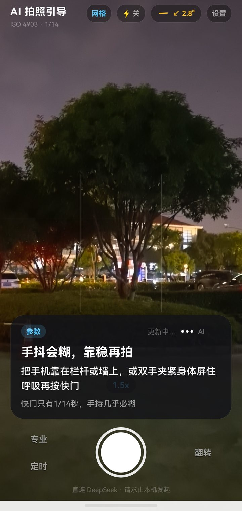
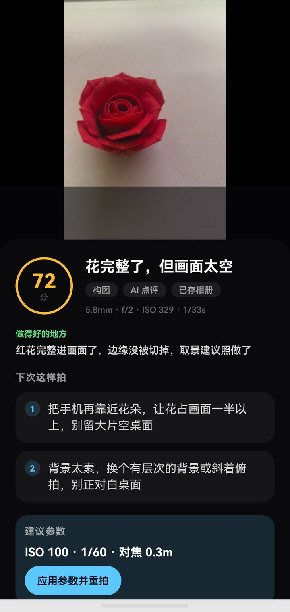
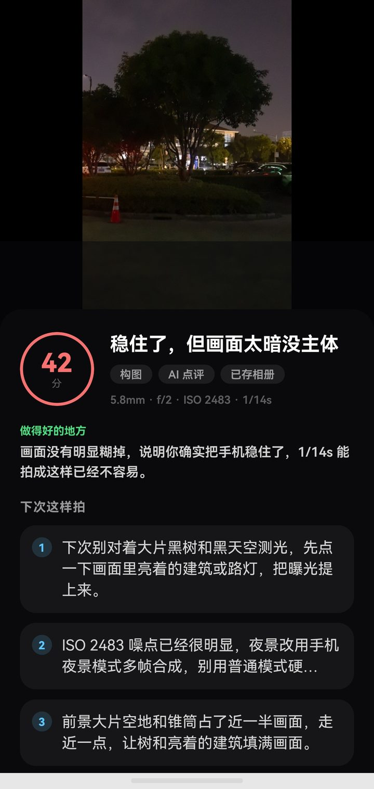
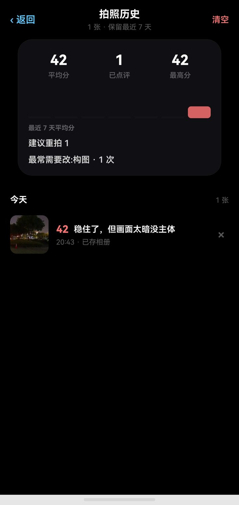
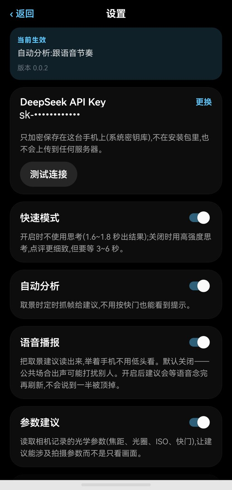

# AI Photo Guide

[](https://github.com/summerfallenleaves/ai-guide-photo/actions/workflows/ci.yml)
[](https://github.com/summerfallenleaves/ai-guide-photo/actions/workflows/android.yml)
[](./LICENSE)
[](https://github.com/summerfallenleaves/ai-guide-photo/releases)

[简体中文](./README.md) | **English**

An AI camera that tells you **what to physically do** while you frame a shot —
"move the phone forward, let the rose fill the lower half" — not "composition is bad".
After the shot it scores the photo, tells you what worked, and can **apply its suggested
camera settings with one tap**.

- Built for ordinary phone users, not pro photographers
- **No backend**: the app talks to DeepSeek directly; your API key never leaves the device
- Android only. iOS untested, HarmonyOS NEXT unsupported

<p align="center">
  
  &nbsp;
  
  &nbsp;
  
</p>

<p align="center">
  
  &nbsp;
  
</p>

<p align="center">
  <sub>Camera → review → strict review · growth stats · settings</sub>
</p>

## What it does

### Camera

The camera is a **custom Camera2 implementation** (not `expo-camera`), which is the only way to
get real control over exposure.

| Feature | Notes |
| --- | --- |
| Pinch to zoom | 1x up to the device's max digital zoom |
| Tap to focus | Focus ring; metering follows the tap |
| Flash | Off / auto / torch (hidden if the device has no flash) |
| Pro panel | Translucent sheet: exposure comp / ISO / shutter / focus / white balance |
| Timer | Off / 3 s / 10 s, tap anywhere to cancel |
| Volume-key shutter | Same code path as the on-screen shutter (timer included) |
| WYSIWYG | Preview and photo are strictly aligned (fill ratio 0.25 + matching crop) |

The UI is locked to portrait. Photo orientation follows the device's physical orientation,
independent of the UI.

### AI

| Mode | Behaviour |
| --- | --- |
| Live guidance | Grabs a frame every few seconds and gives **one** actionable suggestion |
| Post-shot review | Score + what worked + improvements + suggested camera settings |
| One-tap apply | Tap "apply settings and reshoot" → back to the camera with values dialled in |

Reviews use a three-level verdict so the model doesn't nitpick a good photo:

| Verdict | Score | Improvements | Settings advice |
| --- | --- | --- | --- |
| `keep` | ≥85 | 0~1 | none |
| `tweak` | 60~85 | 1~2 | optional |
| `reshoot` | <60 | 2~3 | optional |

This is **enforced in code**, not just asked for in the prompt: if the model says `keep` but lists
three problems, it gets truncated to one and the settings advice is dropped.

### Also included

- Photo history: grouped by day, kept for 7 days
- Growth stats: average score, trend, weakest dimension — computed locally, costs no API calls
- Voice guidance (off by default): reads suggestions aloud so you don't look down at the screen
- **Works without an API key** — every camera feature is offline. Without a key the app shows a
  single banner and hides the AI parts; it never blocks the camera

## Architecture

```
Phone app ──HTTPS──▶ api.deepseek.com
   │
   └─ API key stored on device (expo-secure-store / Android Keystore)
```

- No server, no proxy. The key is entered in Settings and never leaves the device
- Send your own endpoint instead? Point "API endpoint" in Settings at it

Camera metadata (ISO, shutter, focus distance) is reported live from `TotalCaptureResult`, plus
static optics from `getCapabilities()`. It is used three ways: injected into the prompt, shown in
the camera header, and shown on the review page.

## Build from source

### Requirements

| Dependency | Version |
| --- | --- |
| Node.js | ≥ 20 |
| JDK | 17 |
| Android SDK | Platform 36+, Build-Tools 36+ |
| NDK | 27.1.12297006 |

Installing [Android Studio](https://developer.android.com/studio) gets you the SDK and NDK.

### Steps

```bash
npm install
npx expo prebuild -p android
export ANDROID_HOME="$HOME/Library/Android/sdk"   # adjust for your OS
./scripts/build.sh assembleRelease
# → android/app/build/outputs/apk/release/app-release.apk
```

Or use the release script, which also syncs the version number:

```bash
./scripts/release.sh 0.0.2
# → assets/apk/ai-guide-photo-v0.0.2.apk
```

`scripts/build.sh` resolves `JAVA_HOME` / `ANDROID_HOME` from the environment first, then falls
back to a project-local `.toolchain/` if present.

### Signing

`npx expo prebuild` signs release builds with the **debug key** — fine for personal use, but you
cannot publish or upgrade an existing install with it. Generate your own:

```bash
keytool -genkeypair -v -keystore my-release.keystore \
  -alias mykey -keyalg RSA -keysize 2048 -validity 10000
```

See [RELEASING.md](./RELEASING.md) for CI signing setup.

## Known limitations

- **iOS untested** — the camera layer is Android-only and would need a rewrite
- **HarmonyOS NEXT unsupported**
- **No optical zoom** — single rear camera (~23 mm equiv), zoom is digital crop
- **ISO capped at 800** — limited low-light quality
- White balance lacks device calibration; extreme colour temperatures may drift

## Documentation

| Doc | For |
| --- | --- |
| [REQUIREMENTS.md](./REQUIREMENTS.md) | Product decisions (historical record) |
| [AGENTS.md](./AGENTS.md) | Engineering conventions and pitfalls (Chinese) |
| [CONTRIBUTING.md](./CONTRIBUTING.md) | How to contribute |
| [RELEASING.md](./RELEASING.md) | Release and signing process |
| [SECURITY.md](./SECURITY.md) | Reporting vulnerabilities |
| [TODO.md](./TODO.md) | Known gaps and unverified behaviour |

## License

[MIT](./LICENSE)
