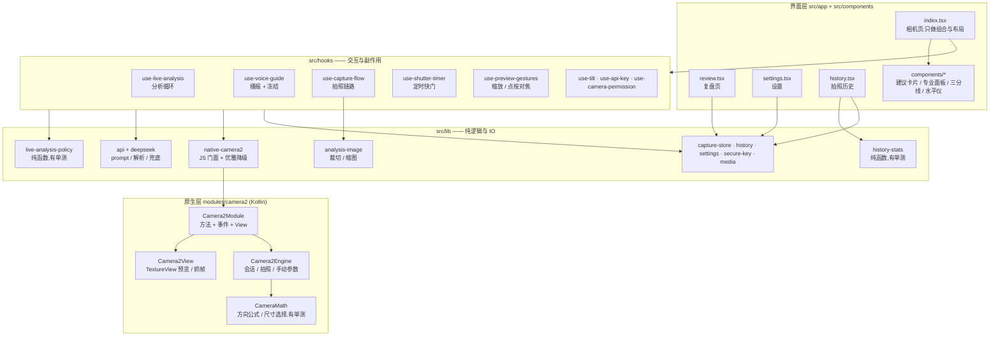
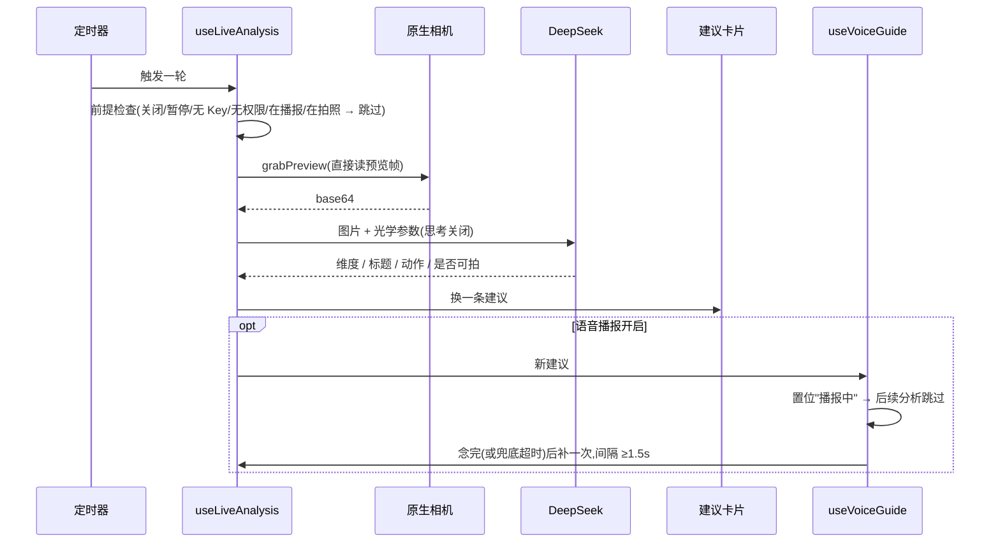
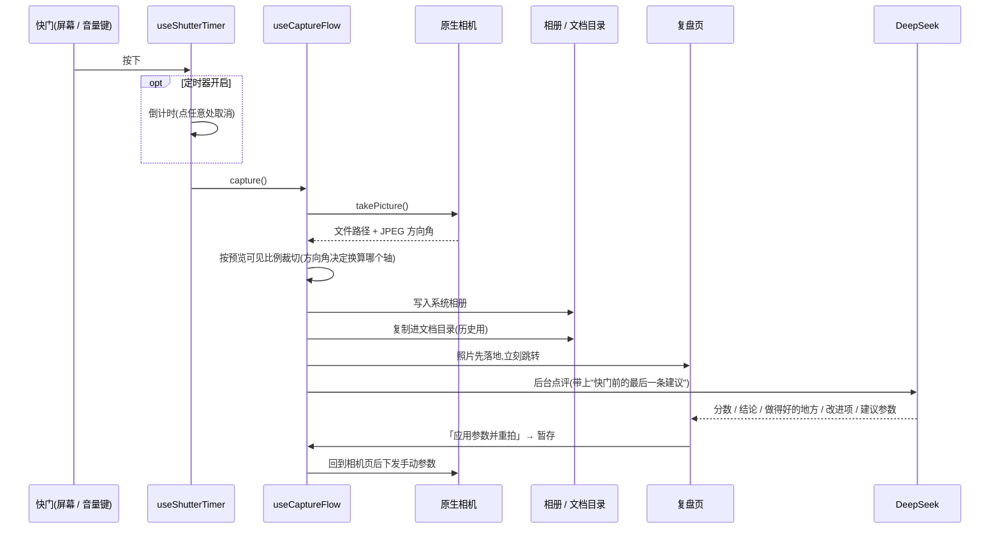

# 架构

只画**职责与流向**,不写函数名和行号 —— 那种细节半年后一定过时,而分层和流向基本稳定。

面向贡献者的操作说明见 [CONTRIBUTING.md](../CONTRIBUTING.md);相机层的实现约定和踩坑记录见
[AGENTS.md](../AGENTS.md) 第六节。

---

## 一、分层

**依赖只能向下**:界面 → hooks → lib → 原生。
反过来的情况只有一种:原生用**事件**（`onReady` / `onParams` / `onError` / `onVolumeKey`）通知上层。

---

## 二、取景建议(每 3~10 秒一轮)

关键取舍:

- **抓的是预览帧,不是拍照** —— 送模型的就是用户眼前这一帧
- **播报期间冻结** —— 一句话 4~5 秒而间隔最短 3 秒,不冻结就会被顶掉半句
- **失败超过 3 次自动暂停** —— 后台期间的失败不算数,否则回前台就是一片红字

---

## 三、拍照到点评

关键取舍:

- **照片先落地再点评** —— 用户不该为了等 AI 盯着快门干站
- **裁切跟着预览走** —— 否则"取景框里看到的"和"拍到的"不一致
- **没有 API Key 也照常拍** —— 只是不进点评,不会拦着你按快门

---

## 四、状态归属

| 数据 | 存在哪 | 写入 | 读取 |
| --- | --- | --- | --- |
| 用户设置(快速模式 / 自动分析 / 间隔 / 语音 / 参数建议) | AsyncStorage | `settings.ts` | `useSettings()` 全局订阅 |
| API Key | SecureStore(系统密钥库) | `secure-key.ts` | `useApiKey()` |
| 刚拍的照片 + 点评状态 + 待应用参数 | 内存 | `capture-store.ts` | 复盘页、相机页 |
| 拍照历史(含照片文件) | AsyncStorage + 文档目录 | `history.ts` | `useHistory()` |
| 历史统计 | 派生(每次渲染现算) | — | `computeHistoryStats()` |
| 实时 ISO / 快门 / 对焦 | 内存(原生事件推送) | `use-live-analysis` 的 `meta()` | 相机页顶栏、prompt |
| 相机硬件能力 | 内存(就绪后取一次) | `getCapabilities()` | 变焦上限、闪光灯、参数档位 |

**约定**:用 `useSyncExternalStore` 订阅,保存后相关页面自动刷新,**不要在各页面各存一份副本**。

---

## 五、没做的部分

架构上明确排除的,避免以后被"怎么没有"困住:

| 没做 | 原因 |
| --- | --- |
| 自建后端 | Key 存设备密钥库就够;多一个服务就多一份运维和泄露面 |
| 端侧图像分析 | 端侧做构图判断的收益远低于直接送模型,而且相机帧在原生层,JS 拿不到高效像素数据 |
| 横屏布局 | 横屏下预览角度/比例反复出问题;拍照方向由设备朝向决定,与界面无关 |
| iOS | 相机层是纯 Android 实现,迁移等于重写 |
