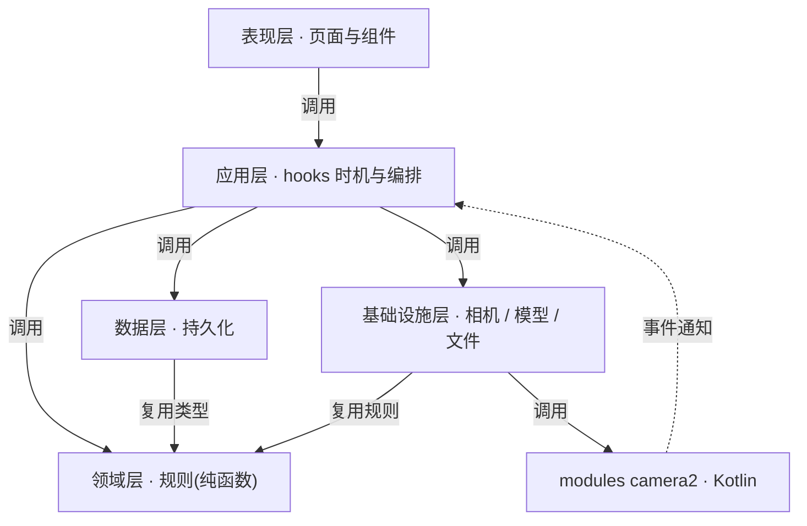
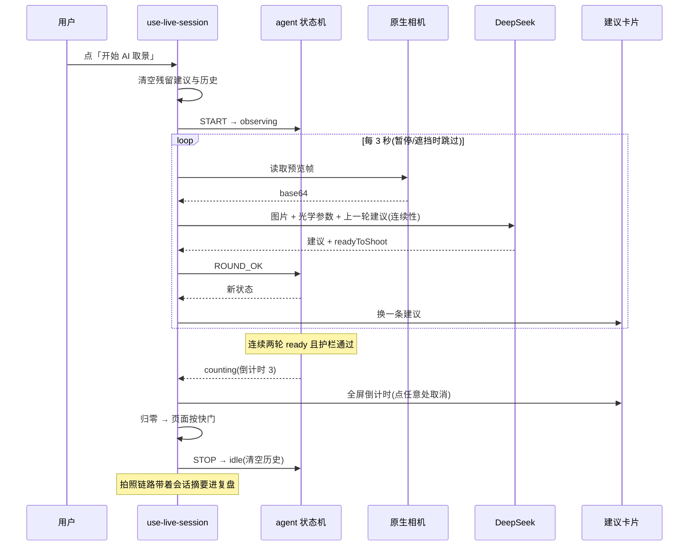
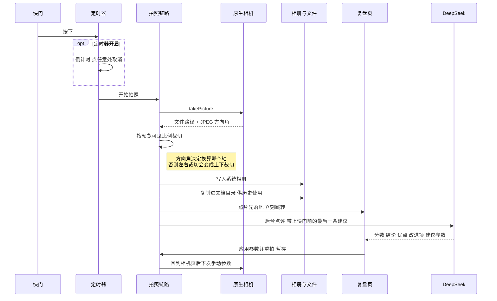

# 架构

只画**职责与流向**,不写函数名和行号 —— 那种细节半年后一定过时,而分层和流向基本稳定。

面向贡献者的操作说明见 [CONTRIBUTING.md](../CONTRIBUTING.md);相机层的实现约定和踩坑记录见
[AGENTS.md](../AGENTS.md) 第六节。

---

## 一、分层

依赖只能向下:表现 → 应用 → (领域 / 数据 / 基础设施) → 原生。
反向只有一种:原生用事件通知上层。

**一条硬边界:相机侧禁止依赖 AI。** 没有 API Key 时相机必须完全可用,
所以 `use-camera-session` / `use-shutter-timer` / `use-preview-gestures` /
`infra/camera` / `infra/media` 都不许 import `domain/guidance` 或 `infra/ai`。
唯一例外是 `use-capture-flow`(拍完请求点评)。这条由 ESLint `no-restricted-imports` 强制。

| 层 | 内容 | 职责 |
| --- | --- | --- |
| **表现层** | `src/app` `src/components` `src/theme.ts` | 只做组合与布局,不含业务判断 |
| **应用层** | `src/hooks` | 管"什么时候做、做多久、什么时候停":副作用、定时、订阅、生命周期 |
| | `use-live-session` | 取景会话:定时抓帧 → 调模型 → 倒计时 → 派发状态机事件 |
| | `use-voice-guide` | 播报,以及播报期间冻结建议 |
| | `use-capture-flow` | 拍照 → 前置镜像 → 存相册 → 进复盘 → 后台点评 |
| | `use-camera-session` | 订阅原生事件、缓存能力、下发参数 |
| | `use-shutter-timer` | 定时快门(关 / 3s / 10s + 音量键) |
| | `use-preview-gestures` | 捏合缩放 + 点按对焦 |
| **领域层** | `src/domain/guidance` | `prompt` · 建议与点评怎么问 | 
| | | `scoring` · 模型输出怎么清洗、verdict 与分数如何自洽 |
| | | `live-analysis-policy` · 能不能跑 / 失败怎么算 / 间隔取多少 |
| | | `history-stats` · 平均分 / 趋势 / 通病维度 |
| | `src/domain/shared` | `types` 领域模型 · `exif` 光学参数 |
| **数据层** | `src/data` | `settings` `secure-key` `history` `capture-store` |
| **基础设施层** | `src/infra/ai` | `client` DeepSeek 传输与报错分类;`index` 对外门面 `analyze()` |
| | `src/infra/camera` | `native-camera2` JS 门面 + 模块缺失时优雅降级 |
| | `src/infra` | `media` 存相册 · `analysis-image` 缩图与前置镜像 |
| **原生层** | `modules/camera2` | `Camera2Module` 接口与事件 · `Camera2View` 预览抓帧 · `Camera2Engine` 会话拍照参数 · `Camera2Math` 纯计算 |

| 层 | 内容 | 职责 |
| --- | --- | --- |
| 界面层 | `src/app` `src/components` | 只做组合与布局,不含业务判断 |
| hooks | `use-live-session` | 会话运行时:抓帧、调模型、倒计时 |
| | `use-voice-guide` | 播报,以及播报期间冻结建议 |
| | `use-capture-flow` | 拍照 → 前置镜像 → 存相册 → 进复盘 → 后台点评 |
| | `use-shutter-timer` | 定时快门(关 / 3s / 10s) |
| | `use-preview-gestures` | 捏合缩放 + 点按对焦 |
| | `use-tilt` `use-api-key` `use-camera-permission` | 环境类 |
| lib | `live-analysis-policy` | **纯函数**:能不能跑 / 失败怎么算 / 间隔取多少 · 有单测 |
| | `history-stats` | **纯函数**:平均分 / 趋势 / 通病维度 · 有单测 |
| | `api` `deepseek` | prompt、解析、兜底、报错分类 |
| | `native-camera2` | JS 门面 + 模块缺失时的优雅降级 |
| | `analysis-image` | 裁切(含方向换算)/ 缩图 |
| | `capture-store` `history` `settings` `secure-key` `media` | 状态与 IO |
| 原生层 | `Camera2Module` | JS 接口 + 事件 + View 定义 |
| | `Camera2View` | TextureView 预览 / 抓帧 |
| | `Camera2Engine` | 会话 / 拍照 / 手动参数 / 实时参数回报 |
| | `Camera2Bus` | 引擎与 Module 之间的事件中转 |
| | `CameraMath` | 方向公式 / 尺寸选择 · 有单测 |

---

## 二、取景会话(点「开始 AI 取景」之后)

关键取舍:

- **会话即连续性**:开/关就是边界,不需要检测"画面是否还是同一个场景"
- **模型只说,代码决定拍**:`readyToShoot` 只是信号,真正按快门要过护栏(连续两轮 + 开关 + 未遮挡)
- **连续两轮**抵消"抓帧 → 模型返回"约 1.8 秒的延迟
- **记忆在运行时**:状态机只管阶段与计数,建议时间线在 hook 的 ref 里

## 三、拍照到点评

关键取舍:

- **照片先落地再点评** —— 用户不该为了等 AI 盯着快门干站
- **裁切跟着预览走** —— 否则"取景框里看到的"和"拍到的"不一致
- **没有 API Key 也照常拍** —— 只是不进点评,不会拦着按快门

---

## 四、状态归属

| 数据 | 存在哪 | 写入 | 读取 |
| --- | --- | --- | --- |
| 用户设置(快速模式 / 自动拍摄 / 间隔 / 语音 / 参数建议 / 网格) | AsyncStorage | `data/settings` | `useSettings()` 全局订阅 |
| API Key | SecureStore(系统密钥库) | `data/secure-key` | `useApiKey()` |
| 刚拍的照片 + 点评状态 + 待应用参数 | 内存 | `data/capture-store` | 复盘页、相机页 |
| 拍照历史(含照片文件) | AsyncStorage + 文档目录 | `data/history` | `useHistory()` |
| 历史统计 | 派生(每次渲染现算) | — | `domain/guidance/history-stats` 的 `computeHistoryStats()` |
| 实时 ISO / 快门 / 对焦 | 内存(原生事件推送) | 分析循环取 meta 时 | 相机页顶栏、prompt |
| 相机硬件能力 | 内存(就绪后取一次) | `getCapabilities()` | 变焦上限、闪光灯、参数档位 |

**约定**:用 `useSyncExternalStore` 订阅,保存后相关页面自动刷新,**不要在各页面各存一份副本**。

---

## 五、没做的部分

架构上明确排除的,避免以后被"怎么没有"困住:

| 没做 | 原因 |
| --- | --- |
| 自建后端 | Key 存设备密钥库就够;多一个服务就多一份运维和泄露面 |
| 端侧图像分析 | 端侧做构图判断的收益远低于直接送模型;而且相机帧在原生层,JS 拿不到高效像素数据 |
| 横屏布局 | 横屏下预览角度/比例反复出问题;拍照方向由设备朝向决定,与界面无关 |
| iOS | 相机层是纯 Android 实现,迁移等于重写 |
