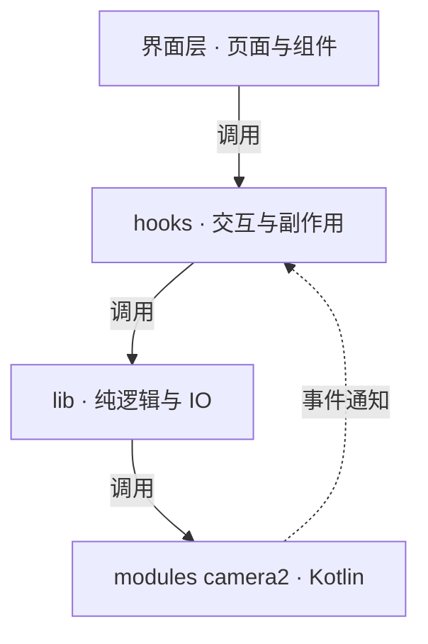
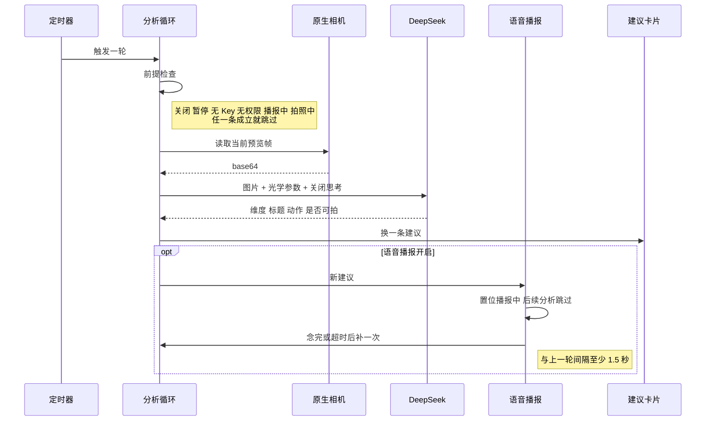
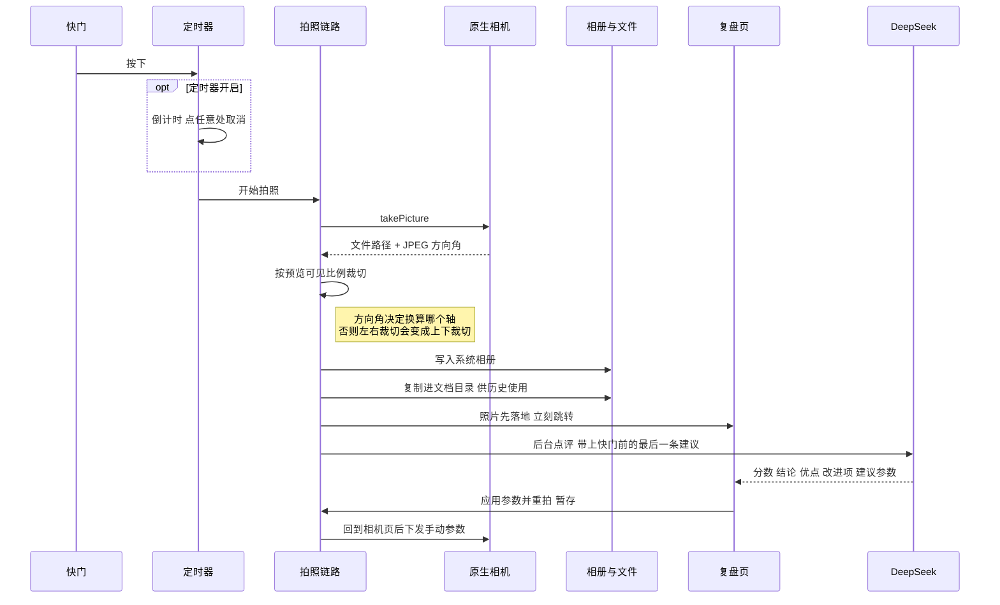

# 架构

只画**职责与流向**,不写函数名和行号 —— 那种细节半年后一定过时,而分层和流向基本稳定。

面向贡献者的操作说明见 [CONTRIBUTING.md](../CONTRIBUTING.md);相机层的实现约定和踩坑记录见
[AGENTS.md](../AGENTS.md) 第六节。

---

## 一、分层

依赖只能向下。反过来的情况只有一种:原生用事件通知上层。

| 层 | 内容 | 职责 |
| --- | --- | --- |
| 界面层 | `src/app` `src/components` | 只做组合与布局,不含业务判断 |
| hooks | `use-live-analysis` | 分析循环:抓帧 → 调模型 → 失败暂停 → 定时器 |
| | `use-voice-guide` | 播报,以及播报期间冻结建议 |
| | `use-capture-flow` | 拍照 → 裁切 → 存相册 → 进复盘 → 后台点评 |
| | `use-shutter-timer` | 定时快门(关 / 3s / 10s) |
| | `use-preview-gestures` | 捏合缩放 + 点按对焦 |
| | `use-tilt` `use-api-key` `use-camera-permission` | 环境类 |
| lib | `live-analysis-policy` | **纯函数**:能不能跑 / 失败怎么算 / 间隔取多少 · 有单测 |
| | `history-stats` | **纯函数**:平均分 / 趋势 / 通病维度 · 有单测 |
| | `api` `deepseek` | prompt、解析、兜底、报错分类 |
| | `native-camera2` | JS 门面 + 模块缺失时的优雅降级 |
| | `analysis-image` | 裁切(含方向换算)/ 缩图 |
| | `capture-store` `history` `settings` `secure-key` `media` | 状态与 IO |
| 原生层 | `Camera2Module` | JS 接口 + 事件 + View 定义 |
| | `Camera2View` | TextureView 预览 / 抓帧 |
| | `Camera2Engine` | 会话 / 拍照 / 手动参数 / 实时参数回报 |
| | `Camera2Bus` | 引擎与 Module 之间的事件中转 |
| | `CameraMath` | 方向公式 / 尺寸选择 · 有单测 |

---

## 二、取景建议(每 3~10 秒一轮)

关键取舍:

- **抓的是预览帧,不是拍照** —— 送模型的就是用户眼前这一帧
- **播报期间冻结** —— 一句话 4~5 秒而间隔最短 3 秒,不冻结就会被顶掉半句
- **失败超过 3 次自动暂停** —— 后台期间的失败不算数,否则回前台就是一片红字

---

## 三、拍照到点评

关键取舍:

- **照片先落地再点评** —— 用户不该为了等 AI 盯着快门干站
- **裁切跟着预览走** —— 否则"取景框里看到的"和"拍到的"不一致
- **没有 API Key 也照常拍** —— 只是不进点评,不会拦着按快门

---

## 四、状态归属

| 数据 | 存在哪 | 写入 | 读取 |
| --- | --- | --- | --- |
| 用户设置(快速模式 / 自动分析 / 间隔 / 语音 / 参数建议) | AsyncStorage | `settings.ts` | `useSettings()` 全局订阅 |
| API Key | SecureStore(系统密钥库) | `secure-key.ts` | `useApiKey()` |
| 刚拍的照片 + 点评状态 + 待应用参数 | 内存 | `capture-store.ts` | 复盘页、相机页 |
| 拍照历史(含照片文件) | AsyncStorage + 文档目录 | `history.ts` | `useHistory()` |
| 历史统计 | 派生(每次渲染现算) | — | `computeHistoryStats()` |
| 实时 ISO / 快门 / 对焦 | 内存(原生事件推送) | 分析循环取 meta 时 | 相机页顶栏、prompt |
| 相机硬件能力 | 内存(就绪后取一次) | `getCapabilities()` | 变焦上限、闪光灯、参数档位 |

**约定**:用 `useSyncExternalStore` 订阅,保存后相关页面自动刷新,**不要在各页面各存一份副本**。

---

## 五、没做的部分

架构上明确排除的,避免以后被"怎么没有"困住:

| 没做 | 原因 |
| --- | --- |
| 自建后端 | Key 存设备密钥库就够;多一个服务就多一份运维和泄露面 |
| 端侧图像分析 | 端侧做构图判断的收益远低于直接送模型;而且相机帧在原生层,JS 拿不到高效像素数据 |
| 横屏布局 | 横屏下预览角度/比例反复出问题;拍照方向由设备朝向决定,与界面无关 |
| iOS | 相机层是纯 Android 实现,迁移等于重写 |
